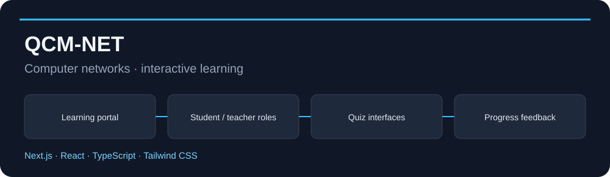

<div align="center">

# QCM-NET



**Computer networks · interactive learning**

Next.js · React · TypeScript · Tailwind CSS

</div>

## Overview

A web interface for teaching and evaluating computer networking concepts through multiple-choice exercises, designed around student and teacher experiences for ENSIT Tanger.

## Product experience
| Student | Teacher |
| --- | --- |
| Learning and quiz interfaces | Course creation entry point |
| Progress and feedback concepts | Dedicated teacher dashboard |

## Structure
- `app/student/` and `app/teacher/`: role-specific routes.
- `app/login/` and `app/signup/`: account entry screens.
- `components/`: reusable interface elements.
- `lib/` and `hooks/`: shared frontend logic.

## Run locally
```bash
pnpm install
pnpm dev
```
Visit http://localhost:3000. Build with `pnpm build`.

## Scope
The repository presents an educational web prototype. Production authentication, authorization and backend persistence are not asserted.
